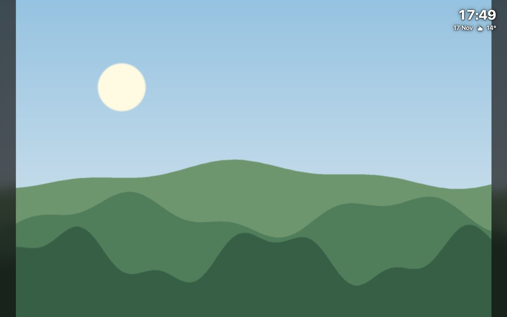
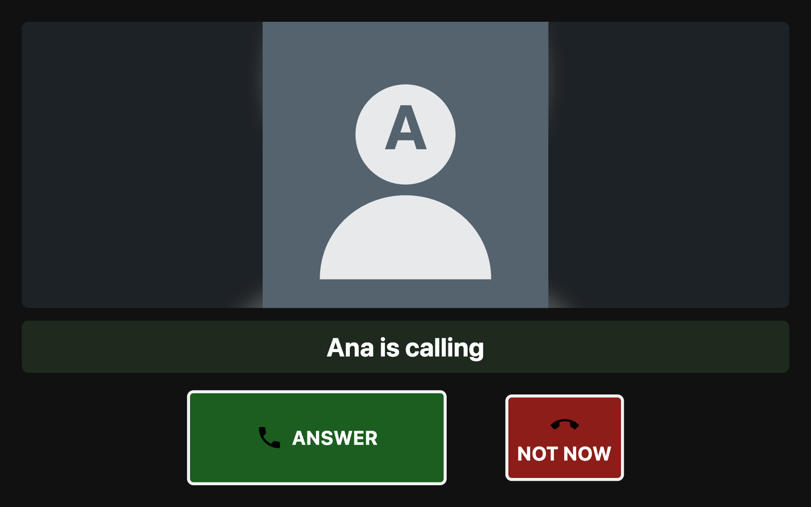
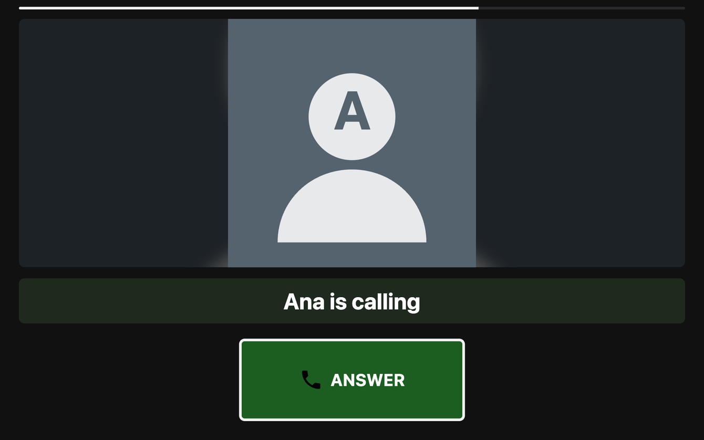
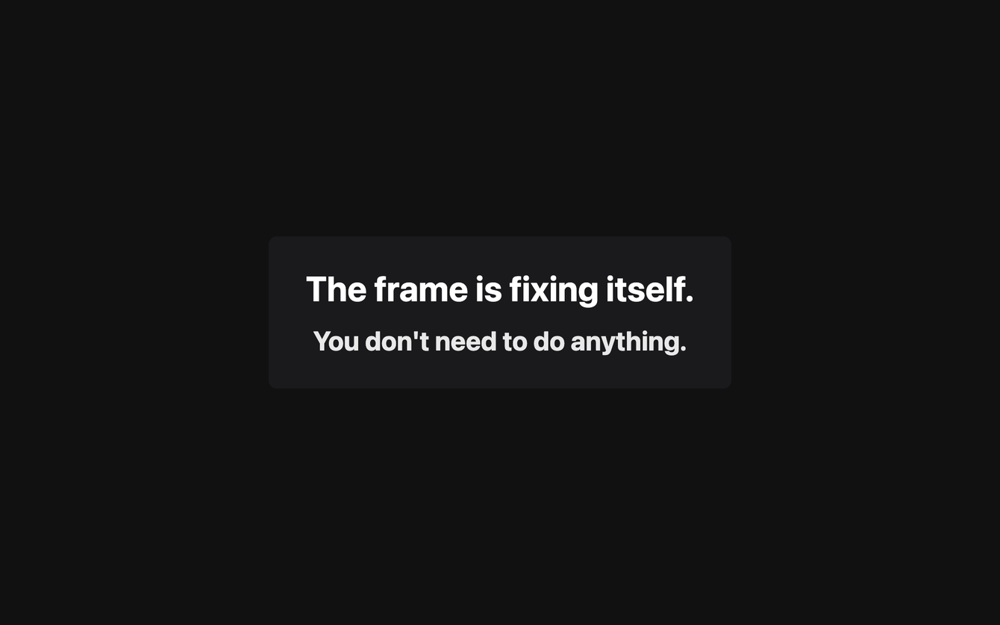
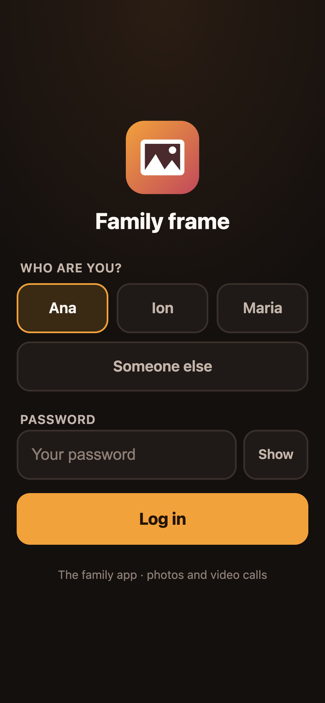
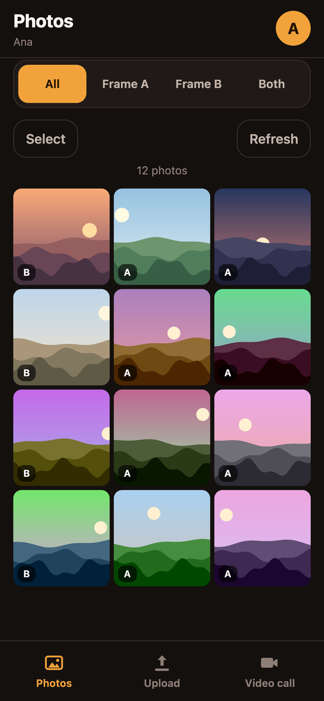
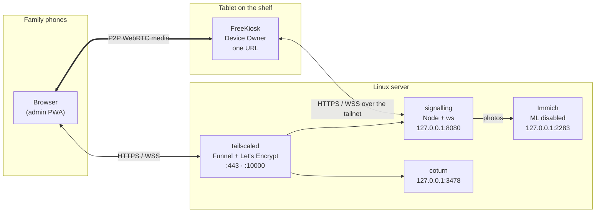

# frameo-clone

A self-hosted digital photo frame for grandparents that is also a one-button video phone. It runs
on a second-hand Android tablet and a Linux box you already have, with **no subscription, no
cloud and no vendor account**.

Family members send photos from their phones through a small web app. The photos appear on the
tablet on the grandparents' shelf. When someone calls, the photos give way to a full-screen call
with one big green button. The grandparents never install, update, log in to or configure
anything.

> **Status:** a working reference build, not a maintained product. It has run daily since August
> 2026 on one server and one Samsung Galaxy Tab A9+. The interface is in English and Romanian
> (see [Languages](#languages)).

| The frame, showing photos | Someone is calling |
|---|---|
|  |  |
| **After a wrong "not now": 5 seconds to answer anyway** | **The only failure screen** |
|  |  |

| Family app: login | Family app: photos |
|---|---|
|  |  |

Screenshots are from the real web apps in a desktop browser, in English (Romanian is the other
built-in language), with generated sample images instead of family photos.

## Why

Commercial frames such as Frameo cap free sends at 10 photos at a time and put the rest behind a
subscription. A used Android tablet costs less than the frame, has a better screen, and has the
camera, microphone and speaker needed for video calls. Everything else needed here is free and
open source. The write-up behind the project is at
[voic.ro/blog/i-built-my-own-frameo](https://voic.ro/blog/i-built-my-own-frameo).

## How it was built

**Almost all of the code was written by Claude Code (Anthropic's coding agent) from my spec.** I
described the requirements and the UX rules, reviewed the behaviour, and tested it on my own
hardware. I have not reviewed every line. Treat it as a working example you can learn from and
adapt, not as audited software.

## How it works

**Photos: Immich.** Runs with the machine-learning container removed, which keeps it around
1–1.5 GB of RAM. There is one album per frame plus one shared album. Family members upload through
the phone app (`/admin/`), which sends the files to the signalling server, which stores them in
Immich. There is no 10-photo cap and no app to install; Immich handles HEIC, EXIF rotation and
thumbnails.

**Calls: plain peer-to-peer WebRTC.** With two participants per call there is no need for a media
server. A small Node signalling server only passes the call setup messages; the video goes
directly between the phone and the tablet. When a phone on mobile data can't reach the tablet
directly, coturn relays the call.

**Ringing.** The tablet keeps a WebSocket open to the signalling server, and a call rings it over
that connection. The tablet is always plugged in, so Android's Doze never applies, and the
[watchdog](server/tablet/README-watchdog.md) brings Tailscale back if it drops after a reboot.

**Reach: Tailscale Funnel.** `tailscale funnel` publishes the web app on port 443 and coturn on
port 10000, with an automatically renewed Let's Encrypt certificate. A real certificate matters:
browsers only allow camera and microphone on a secure origin. Immich is never published; it is
only reachable through the signalling server. No container port listens on `0.0.0.0`, and no router
change is needed.

### Designed for the people using it

- **The answer button is 2.4 times the area of decline**, and green, with a 27 mm gap between them.
  Sizes are in real millimetres, calculated from the tablet's physical screen size, not pixels.
- **One tap only.** No swipe, double-tap, long-press or scroll anywhere on the frame.
- **A wrong decline costs one tap:** the answer button stays on screen for 5 more seconds.
- **45-second ring**, so there is time to cross the room. The ring is a warm, low two-tone bell
  that ramps from 55% to 100% volume over 6 seconds.
- **No dialer, keyboard or contact list.** Calling out is a grid of face photos with a 3-second
  undo. Who may call whom is enforced by the server, not by hiding buttons.
- **About 300 photos cached on the tablet**, so a server or network outage doesn't show.
- **No error messages.** If something breaks, the frame shows one calm line ("The frame is fixing
  itself. You don't need to do anything.") and repairs itself in the background.

## Languages

The frame and the phone app are in English and Romanian. Each device picks Romanian when its own
language is Romanian, and English otherwise. To choose explicitly, add `&lang=en` or `&lang=ro` to
the frame's kiosk URL (it is remembered), or switch it in the phone app's account menu.

## Getting started

1. Set up the server: [INSTALL.md](INSTALL.md).
2. Set up each tablet: [docs/TABLET.md](docs/TABLET.md).

### Requirements

- A Linux box on 24/7 with Docker, systemd, cgroup v2 and about 4 GB of spare RAM.
- A Tailscale account with MagicDNS, HTTPS certificates and Funnel enabled.
- One or two Android tablets that can be factory-reset and made Device Owner, permanently plugged
  in.

Container memory is capped at 3968m in total: immich 2048m + postgres 1024m + redis 256m +
signalling 512m + coturn 128m.

## Limitations

- **Two languages only**, English and Romanian. Adding one means adding a column to the
  `STRINGS` table in `public/app.js` and `public/admin/app.js`.
- **Built around Tailscale Funnel.** There is no setup for a plain reverse proxy or your own
  domain.
- **Tested on one tablet model** (Samsung Galaxy Tab A9+) and one server.
- **Two frames are assumed** in the phone app's album picker (`frame-a`, `frame-b`), and the login
  buttons are a hardcoded list (`DEFAULT_ACCOUNTS` in `public/admin/app.js`). INSTALL.md says what
  to edit.
- **Calls over mobile data are relayed over TCP through Funnel**, so quality is lower than on Wi-Fi.
  See [server/ARCHITECTURE-PUBLIC.md](server/ARCHITECTURE-PUBLIC.md).
- **No automated tests.** `npm run check` only checks syntax.
- **Tailscale node keys expire after 180 days** unless you disable key expiry for the server and
  the tablets. If you don't, remote access quietly stops about six months in.

## Repository layout

| Path | What |
|---|---|
| [`INSTALL.md`](INSTALL.md) | Server setup, step by step |
| [`docs/TABLET.md`](docs/TABLET.md) | Tablet setup: FreeKiosk, Device Owner, kiosk URL, getting back out |
| [`server/signalling/`](server/signalling) | The Node signalling server, admin API, and the web apps (`public/` for the frame, `public/admin/` for the family) |
| [`server/tablet/`](server/tablet) | Tablet-side watchdog that keeps Tailscale alive and reports heartbeats |
| `server/docker-compose.*.yml` | Immich, signalling and coturn stacks |
| `server/deploy.sh`, `expose-public.sh`, `healthcheck.sh` | Deploy, publish through Funnel, and verify |
| `server/import-photos.js` | Seed the library from a folder of photos |
| [`server/ARCHITECTURE-PUBLIC.md`](server/ARCHITECTURE-PUBLIC.md) | Security design: why each decision was made and what breaks if it is reversed |
| [`server/README-ops.md`](server/README-ops.md) | Day-to-day operations, backups, troubleshooting |

## License

[MIT](LICENSE)
